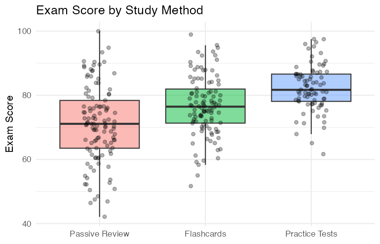

# Data Science (CS301) Lab 5 Assignment

__Fall 2026__

Comparing Groups with t-tests, ANOVA and MANOVA in R

**Assigned** : Thursday, 29th October 2026

**Due** : Thursday, 5th November 2026

**Lab Expiration Date**: Thursday, 12th November 2026

Note: This is the last date that you can submit this work for a grade.

Another note: Parts of this lab were created using Claude.



Welcome to Lab 05! In this assignment, you will fix and complete a partially broken R script that compares groups of students using t-tests, ANOVA and MANOVA. Every test in this lab is paired with a plot, because a good data scientist always __looks first and tests second__. You will also explore an amazing Shiny app that lets you experiment with the same tests on many different datasets. 


## Project Goals

So what is this, you ask? Today you'll work with a synthetic dataset about student study habits and wellness while practicing how to choose, run and interpret statistical tests that compare group averages.

You will develop the following skills:

* __Debug and Complete R Code__: Fix broken lines (wrong formulas, backwards logic, missing arguments) and fill in missing pieces using the hints provided in each ToDo
* __Run Group-Comparison Tests__: Apply the Welch t-test, paired t-test, one-way ANOVA with Tukey post-hoc, and one-way MANOVA
* __Visualize Before You Test__: Use boxplots, scatterplots, histograms and heatmaps to see whether a test is necessary
* __Interpret Results__: Decide whether results are statistically significant, how large the effects are, and what the results do (and do not) tell us
* __Explore Interactively__: Use a Shiny app to see how effect size, noise and sample size change plots and p-values. Neat-O, right!?
* __Communicate Findings__: Explain your reasoning clearly in the reflection. Please be sure to use clear and meaningful language for this part!


## Data

You will be working with a __synthetic__ (computer-generated) dataset of 300 students. The filename is `data/student_wellness.csv`. No real students are in this data, but it was built to behave like a realistic study-habits survey.

By the way, you can also create fake data like the data below by heading over to the [Data-Gators](https://data-gators.com/resources/data_generator/) nifty site. You might need to create data to test your own code sometime.

| Column | Type | Description |
| --- | --- | --- |
| `student_id` | text | Anonymous student identifier |
| `study_method` | group (3) | Passive Review, Flashcards, or Practice Tests |
| `device` | group (2) | Takes notes on a Laptop or on Paper |
| `sleep_schedule` | group (3) | Early Bird, Regular, or Night Owl |
| `campus_zone` | group (4) | North, South, East, or West of campus (where the student lives) |
| `hours_studied` | number | Weekly study hours |
| `pre_test` | number | Score before the study program (0-100) |
| `post_test` | number | Score after the study program (0-100) for the SAME student |
| `exam_score` | number | Final exam score (0-100) |
| `project_score` | number | Final project score (0-100) |
| `stress_level` | number | Self-reported stress (1 = calm, 10 = very stressed) |


## What To Do

This lab has three amazing parts;

- an R programming section
- a Shiny app exploration
- a reflection section.

(and all are lovely!)

### Part 1: Data Analysis with R (Technical Component)

Complete the R script in `src/analysis.R`. Look out for the `ToDo` comments that indicate where you need to add or fix code. Some ToDos ask you to __fill in__ missing code (`# YOUR CODE HERE`) and others ask you to __fix__ code that is broken. Each ToDo has a hint. Please make sure that each task is complete before you move on since each step paves the way for the next.

The analysis is broken down into __7 tasks__ with __11 ToDos__ as follows:

1. __Know Your Groups__ - Count the students in each group
2. __Two-Sample t-test (Welch)__ - Does note-taking device change exam scores? (ToDo 1-4)
3. __Paired t-test__ - Did the same students improve from pre-test to post-test? (ToDo 5)
4. __One-Way ANOVA__ - Does study method change exam scores? Which methods differ? (ToDo 6-7)
5. __An ANOVA You Probably Don't Need__ - Does campus zone change exam scores? (ToDo 8-9)
6. __One-Way MANOVA__ - Does study method change exam score, project score and stress together? (ToDo 10-11)
7. __Summary of Findings__ - A single table of every test

When you run the script, plots are displayed __and__ saved into `graphics/output/`. Remember to commit these images with your work.

How to start:

1. Open the lab folder as an RStudio project, or set the working directory to the lab folder (`Session > Set Working Directory`), so that `data/student_wellness.csv` can be found.
2. Run the script from the top, one section at a time. Read the plot first and write down what you expect the test to say. Then run the test.

### Part 2: The Shiny App (Exploration Component)

The folder `shiny/` contains an interactive app. Open `shiny/app.R` in RStudio and press __Run App__, or run `shiny::runApp("shiny")` from the lab folder.

In the app you will:

* Pick a dataset (the lab data, `iris`, `ToothGrowth`, `PlantGrowth`, `chickwts`, `mtcars`, or a __simulator__ where you decide how big the true difference is)
* Pick a test (t-test, ANOVA or MANOVA), the grouping variable, and the outcome(s)
* __Look at the plot first__ and read the eyeball guide, which tells you whether a test looks necessary
* __Run the test anyway__ to see the p-value, the shaded p-value area under the null distribution, and (for ANOVA and MANOVA) the follow-up tests. Can you see a connection forming between the visuals and the p-values of tests?
* Check the assumptions tab to check the distribution of the data.
* Work through the "Try this" tab for guided experiments. Make your own experiments!

You do not submit anything from the app. Use what you learn to answer reflection questions Q9-Q11.

### Part 3: Critical Reflection (Analytical Component)

Complete the reflection questions in `writing/reflection.md`. There are __11 questions__: 8 about your R analysis and 3 about the Shiny app.


## Deliverables

### 1. Completed R Programming Code

* Source code __File__: `src/analysis.R`

__Requirements__:

* Complete all TO-DO sections throughout the script, then delete the `ToDo` tags, in addition to the `YOUR CODE HERE` tags
* Please ensure that the whole script executes from top to bottom without errors
* Be sure to add your name and the date at the top before you submit your work
* Please also be sure to add some comments explaining what the results mean at the end of the script

### 2. Reflection Analysis

Markdown __File__: `writing/reflection.md`

__Requirements__:

* Answer all reflection questions with clear and meaningful language -- __no one-liners__ please!
* Please use clear and meaningful language as you write
* Support arguments with specific numbers (p-values, means, effect sizes) and plots from your analysis
* Include your name and date at the top of the document

### 3. Output Plots

* The images created in `graphics/output/` when you run your script


## Interesting Resources

Much of the inspiration for this lab came from the below materials if you are interested in reading more.

### R Programming Help

* [R for Data Science](https://r4ds.hadley.nz/) - Comprehensive tidyverse guide
* [ggplot2 Documentation](https://ggplot2.tidyverse.org/) - Visualization reference
* In the R console, try `?t.test`, `?aov`, `?TukeyHSD` and `?manova`

### Statistics Help

* [Mastering Shiny](https://mastering-shiny.org/) - If you want to learn how apps like the one in this lab are built
* [Cohen's d explained](https://en.wikipedia.org/wiki/Effect_size#Cohen's_d) - What "small", "medium" and "large" mean

Note: if you find any excellent resources, then please post them to the course' Discord channel to let the class (and your instructor too!) know about your discovery! If they concern concepts from our course, then so much the better!


## Submitting Assignments

You are to submit your completed lab assignment by pushing your changes to your GitHub repository. As you are working on your lab, you are to commit and push regularly. The commands are the following.

``` bash
git add -A
git commit -m "Your notes about commit here" 
git push
```

## Project Assessment

The grade that a student receives on this assignment will have the following components.

* **Mastery of Technical Writing [up to 40%]:**: Students will also receive a checkmark grade when the responses to the writing questions presented in the `reflection.md` reveal a proficiency of both writing skills and technical knowledge. To receive a checkmark grade, the submitted writing should have correct spelling, grammar, and punctuation in addition to following the rules of Markdown and providing conceptually and technically accurate answers.

* **Mastery of Technical Knowledge and Skills [up to 60%]:** Students will receive a portion of their assignment grade when their program implementation reveals that they have mastered all of the technical knowledge and skills developed during the completion of this assignment. As a part of this grade, the instructor will assess aspects of the programming including, but not limited to, the completeness and the correctness of the program and the use of effective source code comments.

## GatorGrade

### Checks for GatorGrader

For immediate feedback on submissions, we will be using Gator Grade to inform the of missing components in the submission. As you submit, you will notice that there is a thick red X that will change to a green check mark when all components have been included in the submission. You are encouraged to click on the red X to find a listing of the components to address.

Offline, you can check the baseline writing and commit requirements for this lab assignment by running department's assignment checking `gatorgrade` tool. To use `gatorgrade`, you first need to make sure you have Python3 installed (type `python --version` or `python3 --version` to check). If you do not have Python installed, please see:

* [Setting Up Python on Windows](https://realpython.com/lessons/python-windows-setup/)
* [Python 3 Installation and Setup Guide](https://realpython.com/installing-python/)
* [How to Install Python 3 and Set Up a Local Programming Environment on Windows 10](https://www.digitalocean.com/community/tutorials/how-to-install-python-3-and-set-up-a-local-programming-environment-on-windows-10)

Then, if you have not done so already, you need to install `gatorgrade`:

* First, [install `pipx`](https://pypa.github.io/pipx/installation/)
* Then, install `gatorgrade` with `pipx install gatorgrade`

Finally, you can run `gatorgrade`:

`gatorgrade --config config/gatorgrade.yml`


## Seeking Assistance

If you have questions, please ask the Technical Leaders or the instructor.
